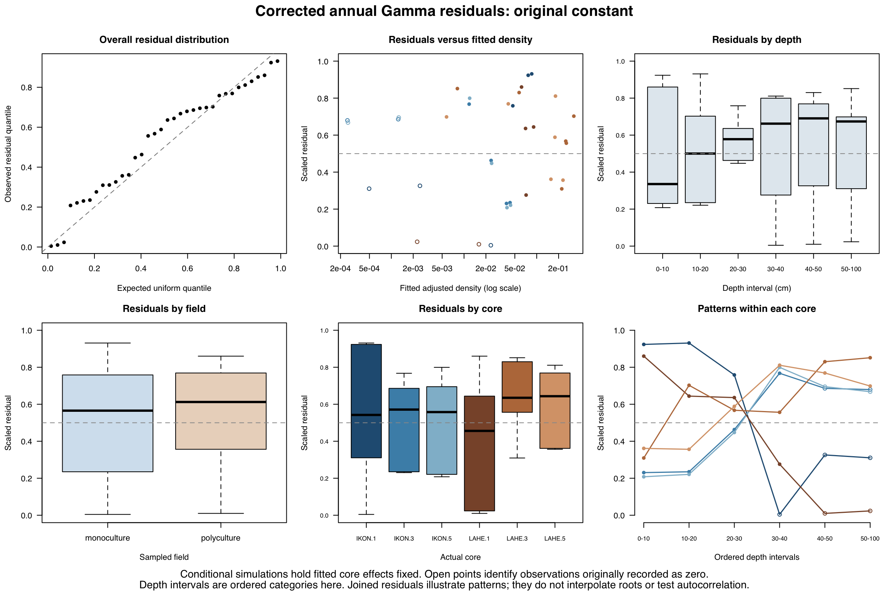

# Root-model sensitivity and diagnostics

Historical stock-profile, orchard covariance and superseded figure files are now stored at their original relative paths inside the [history ZIP](../archive/Analysis_History_2026-10-20.zip). The ZIP manifest records their original sizes and hashes. Current analyses and publication assets remain outside the archive.

These detailed checks accompany the root-density results in the paper. The tables, diagnostic image and supporting notes are retained here after shortening the manuscript and supplement. They were previously presented as Supplemental Table S3 and Supplemental Figure S2. No models were rerun for this documentation change.

## Details retained from Statistical analysis

The 19 October 2026 editorial revision condensed the manuscript's Statistical analysis section. The implementation details below preserve the methods used for the existing results.

Models were fitted separately for each system and response in R 4.6.0 and 4.6.1 using glmmTMB. Annual models covered 0–100 cm; orchard and hedgerow models covered 0–75 cm. Management, categorical depth interval and their interaction were fixed effects, with a core random intercept for repeated depth increments. Non-root models used sum-to-zero contrasts for Type III tests. For Gamma responses, variance increases with the square of the fitted mean; residual variance was not modeled separately by management category.

### Root fits and test targets

Root-density models used Gamma distributions and log links, fitted by maximum likelihood, with constant dispersion within each model and no separate zero-inflation component. Samples with no recovered roots were retained. The modeled response was 1000 × (root dry mass [g] + 0.00017 g) / sampled soil volume [cm³], with the added mass applied to every observation before conversion to mg and volume normalization.

Root fixed effects used asymptotic Wald χ² tests. Management tests compared fitted log-density means with equal weighting across depth intervals; depth tests used equal weighting across management categories. Interaction coefficients were tested jointly. Within-depth and depth-averaged pairwise effects were ratios of fitted means for the constant-adjusted response, with 95% Wald confidence intervals. Depth-averaged contrasts used equal weights on the log scale. Within-depth contrasts were exploratory, and root contrasts were unadjusted for multiple testing. Depth tests compared sampled intervals using root mass per unit sampled soil volume.

Added-mass sensitivity used half to double 0.00017 g for annual fields (0.000085, 0.000170 and 0.000340 g). Orchard and hedgerow checks used 0.1, 0.5, 1, 2 and 10 times 0.00017 g, spanning 0.000017–0.0017 g. Each system retained the same samples and model structure across its sensitivity fits. Numerical convergence was checked, and residual diagnostics used DHARMa 0.5.0. The sections below retain the saved diagnostic settings and results.

### Other responses and follow-up tests

Current C-concentration models use Gamma distributions and log links. Δ¹⁴C and supporting bulk density use Gaussian errors and identity links. Their non-root fixed effects use Type III Wald χ² tests from car. emmeans supplies response-scale model means/SEs, pairwise contrasts and within-depth hedgerow joint tests. Pairwise effects are ratios for Gamma models and differences for Gaussian models. Model-based follow-ups use asymptotic reference distributions and remain unadjusted.

Current cumulative-stock inference uses Welch endpoint comparisons with one observed value per core at each selected depth: 0–100 cm in annual fields, 0–75 cm in orchards, and 0–20 and 0–75 cm in hedgerows. All six hedgerow pairwise p values share one Holm family. The 95% Welch intervals are unadjusted pointwise intervals. Stock panels show observed means ±1SE, not model EMMs. Stocks remain fixed-depth quantities without equivalent-soil-mass adjustment.

Annual and orchard figure symbols mark the retained within-depth pairwise model tests; hedgerow symbols mark within-depth joint tests for C concentration and Δ¹⁴C. Stock panels have no significance markers. Each management category has one field or field-margin location; cores describe within-location variation rather than field-level replication.

The earlier 20 October orchard Gamma(log)/core profile restoration reproduced the selected July values exactly. That prior selection is historical. Its exact driver and complete saved CSVs are retained under `analysis/nonroot_current/historical_cumulative_profile_2026-10-20/`; the current endpoint module is separate. Numerical reproduction does not validate the earlier cumulative-depth covariance assumptions.

## Annual-field sensitivity

Supplemental Table S3. Sensitivity of annual-field root-density comparisons to the added mass and adjustment for six within-depth comparisons.

The Gamma models used a log link, a management × categorical-depth interaction and a core random intercept. The corrected annual dataset contained 36 observations from six cores, including nine samples with no roots recovered. The response was 1000 × (root dry mass + c) / sampled soil volume, with mass in g and volume in cm³. The added mass c was applied to every observation.

### A. Constant-adjusted polyculture/monoculture ratios and unadjusted Wald tests

| Quantity | c = 0.000085 g | c = 0.000170 g | c = 0.000340 g |
| --- | --- | --- | --- |
| Equal-depth ratio (95% CI) | 9.21 (3.64–23.29) | 7.25 (2.88–18.23) | 5.71 (2.34–13.94) |
| Equal-depth p | 2.76 × 10⁻⁶ | 2.55 × 10⁻⁵ | 1.30 × 10⁻⁴ |
| Management × depth p | 0.0221 | 0.1274 | 0.3640 |
| 40–50 cm ratio (95% CI) | 42.58 (9.65–187.85) | 21.23 (5.33–84.53) | 11.09 (3.13–39.22) |
| 50–100 cm ratio (95% CI) | 29.79 (6.75–131.42) | 15.01 (3.78–59.71) | 8.00 (2.27–28.25) |

### B. Holm-adjusted p-values for within-depth comparisons

| Depth (cm) | c = 0.000085 g | c = 0.000170 g | c = 0.000340 g |
| --- | --- | --- | --- |
| 0–10 | 0.2150 | 0.1716 | 0.1373 |
| 10–20 | 0.1935 | 0.1493 | 0.1093 |
| 20–30 | 0.0869 | 0.0628 | 0.0429 |
| 30–40 | 0.0064 | 0.0042 | 0.0031 |
| 40–50 | 4.36 × 10⁻⁶ | 8.79 × 10⁻⁵ | 0.0011 |
| 50–100 | 3.70 × 10⁻⁵ | 6.00 × 10⁻⁴ | 0.0049 |

Ratios describe the constant-adjusted response. The equal-depth ratio is the exponentiated mean of six log field contrasts, not an integrated root-mass ratio. Confidence intervals are pointwise, approximate 95% Wald intervals. Holm adjustment was applied to the six depth tests separately within each constant scenario; it excludes the equal-depth and interaction tests. One field represented each management category, so management and field identity cannot be separated.

### Annual core-deletion sensitivity

Removing each whole core in turn gave 18 fits across the three constants. Every equal-depth ratio and its lower 95% Wald limit remained above one. At c = 0.00017 g, ratios ranged from 4.90 to 11.02. Within-depth precision was less stable: at the same constant, the Holm-adjusted 50–100 cm p-value was 0.0509 after removing LAHE.3, and the 30–40 cm p-value was 0.1187 after removing LAHE.5. These checks assess influence and do not provide additional independent replication.

## Root-model diagnostics

For each of the three constants, 2,000 simulations were evaluated in each of two modes: conditional on fitted core effects and with newly simulated core effects. Uniformity p-values ranged from 0.238 to 0.756, dispersion p-values from 0.395 to 0.840, and outlier p-values were 1. These non-rejections do not establish model adequacy. The adjusted observations cannot fall below 1000c/volume, yet simulations averaged 3.38–3.56 values below that floor per 36 observations. Only 0.3–1.95% of simulated datasets had none below it. This predictive mismatch limits interpretation of the Gamma estimates; the simulation frequencies are not calibrated hypothesis tests.

The analyzed 0–75 cm root datasets contained four recorded zeros each for orchards (24 observations, six cores) and hedgerows (36 observations, nine cores). Saved Gamma sensitivity checks used 0.1, 0.5, 1, 2 and 10 times 0.00017 g. The orchard equal-depth comparison remained nonsignificant (unadjusted p = 0.1153–0.1491). The hedgerow overall management and interaction tests remained below 0.05, while the 10- versus 30-year contrast remained nonsignificant. At 0.00017 g, 1,000 conditional simulations gave uniformity p = 0.0705 and 0.6508, dispersion p = 0.512 and 0.450, and outlier p = 1 for orchards and hedgerows, respectively. Simulations averaged 1.17 values below the added-response floor per 24 orchard observations and 3.31 per 36 hedgerow observations. Whole-core deletion checks were limited to annual fields.

## Annual residual diagnostic figure

Supplemental Figure S2. Residual diagnostics for the corrected annual Gamma model with 0.00017 g added before volume normalization. Scaled residuals use 2,000 conditional DHARMa simulations with fitted core effects held fixed and no refitting. Panels show, from left to right, the uniform Q–Q plot, residuals against fitted adjusted density (mg cm⁻³; logarithmic axis), and residuals by depth (top row); residuals by field, by core, and ordered within-core profiles (bottom row). Blue and brown shades denote monoculture and polyculture cores; open circles mark zero recovered root mass. The Q–Q reference is the identity line; dashed horizontal reference lines mark 0.5. Joined profiles use ordered depth categories, not proportional depth spacing, and are not an autocorrelation test.

## Data, results and code

- Annual models and added-mass sensitivity: [corrected annual Gamma module](../analysis/corrected_annual_gamma_2026-10-16/). Its saved `field_contrasts.csv` and `omnibus_wald_tests.csv` supply table A above.
- Annual diagnostics, six-depth Holm adjustment and whole-core deletion: [annual validation module](../analysis/corrected_annual_validation_2026-10-16/). Saved outputs include `Holm_six_depth_comparisons.csv`, `leave_one_core_out_contrasts.csv`, `residual_tests.csv`, `below_floor_prediction_check.csv` and `residuals_by_sample.csv`.
- Perennial sensitivity and conditional diagnostics: [current perennial root module](../analysis/current_perennial_root/), with the input table, five-constant results and diagnostic settings in its saved files.
- Diagnostic rendering from saved residuals: [render_saved_annual_diagnostics.R](../figures/render_saved_annual_diagnostics.R). This renderer runs no model fits or simulations.
- The publication workbook retains the unadjusted Table S1 contrasts, observed perennial profiles and current figure values. [REPRODUCIBILITY.md](../REPRODUCIBILITY.md) describes execution and software versions.
